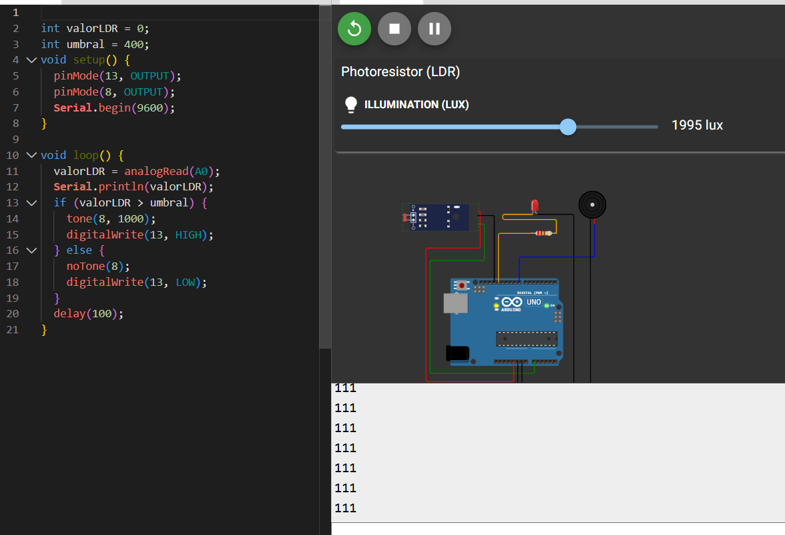
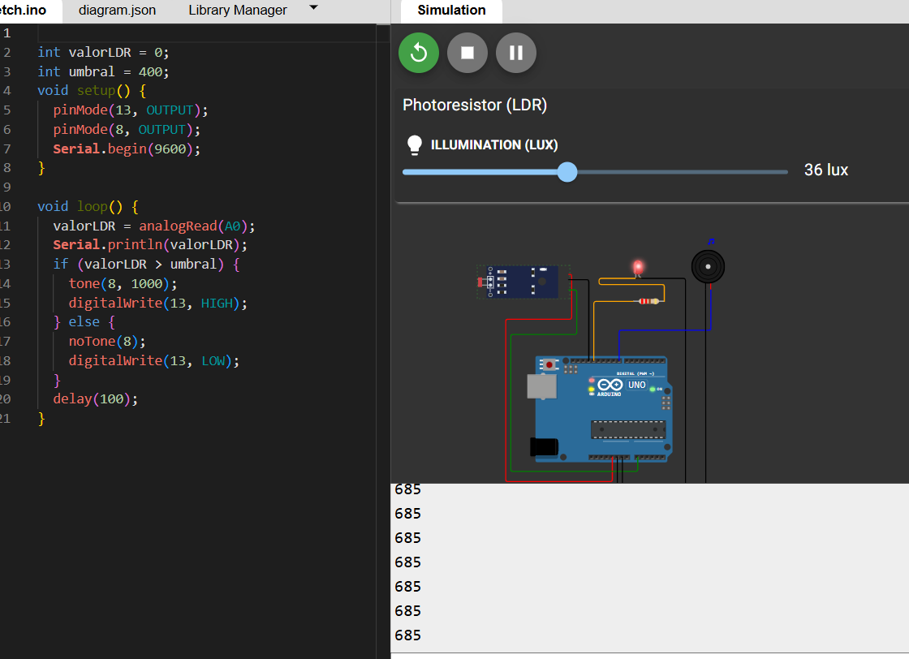
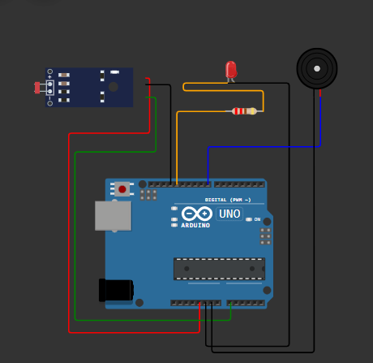
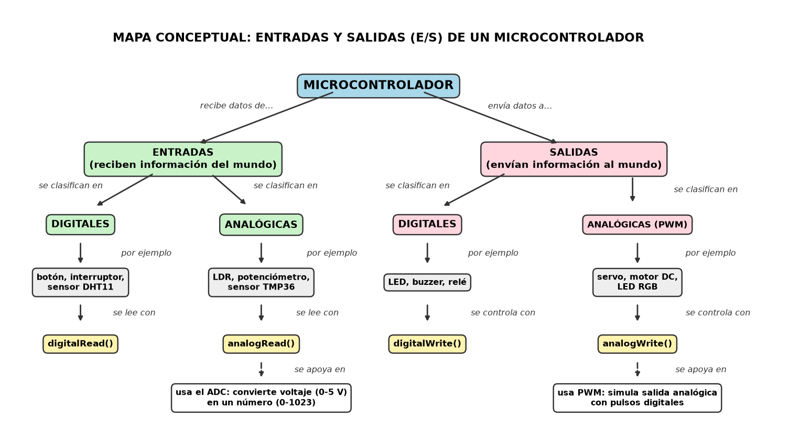

# Act 4 — Circuito alternativo E/S + Mapa conceptual en Python

## 🔌 Circuito: Alarma de luz con LDR (Wokwi)
Sistema de entrada/salida que se activa al oscurecer.

- **Entrada:** fotorresistencia LDR (analógica, pin A0)
- **Salidas:** LED (pin 13) + buzzer (pin 8)
- **Lógica:** si la lectura analógica supera el umbral (400) significa que hay oscuridad → el LED se enciende y el buzzer suena.

**Simulación en Wokwi:** https://wokwi.com/projects/477884819777020929

| ☀️ Con luz (1995 lux) → alarma apagada | 🌙 Oscuridad (36 lux) → ¡alarma activa! |
|---|---|
|  |  |

Circuito armado:

## 🐍 Mapa conceptual: Entradas y Salidas
Generado 100% con Python (matplotlib), siguiendo las reglas del mapa conceptual: conceptos en cajas, jerarquía y palabras de enlace.

### Cómo generarlo

    pip install matplotlib
    python mapa.py

## 📁 Archivos
| Archivo | Contenido |
|---|---|
| `alarma_ldr.ino` | Código Arduino del circuito |
| `mapa.py` | Script que genera el mapa conceptual |
| `Mapa_conceptual.png` | Mapa conceptual final |
| `captura_*.png.png` | Evidencias de la simulación |
